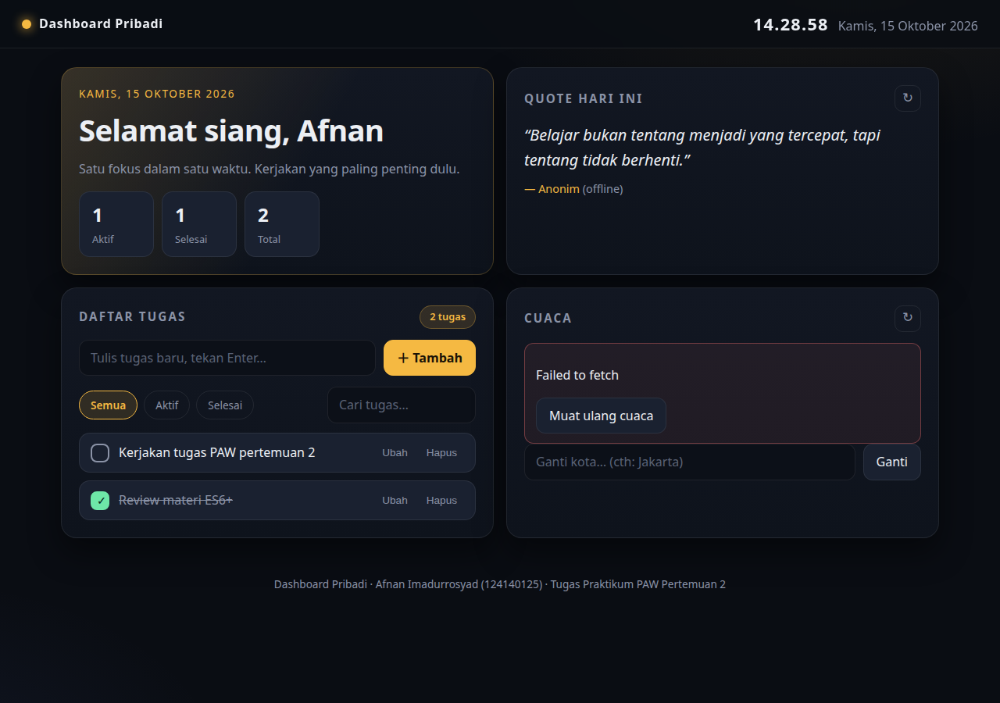
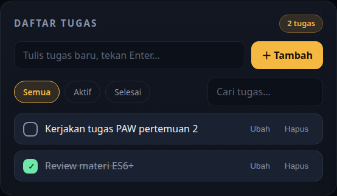

# Dashboard Pribadi — Varian "Midnight Bento" (Dark Only)

**Nama:** Afnan Imadurrosyad
**NIM:** 124140125
**Kelas:** RB
**Mata Kuliah:** Pengembangan Aplikasi Web — Praktikum Pertemuan 2

Varian layout kedua dari tugas Personal Dashboard: tata letak **bento grid** dengan palet **gelap saja** (tanpa toggle tema). Sapaan + statistik di tile sorot, quote harian di tile pendamping, daftar tugas sebagai kartu hero, dan cuaca dengan angka suhu besar.

## Fitur

- **Sapaan + jam live** — sapaan Bahasa Indonesia mengikuti waktu (pagi/siang/sore/malam), jam berjalan tiap detik di topbar, tanggal lengkap di tile sapaan.
- **Daftar tugas** — tambah, ubah, hapus, tandai selesai; filter Semua/Aktif/Selesai; pencarian; statistik Aktif/Selesai/Total; tersimpan di `localStorage` (kunci `dashdark.todos.v1`).
- **Kartu cuaca** — data live dari Open-Meteo (tanpa API key): suhu, kondisi (label Indonesia), kelembapan, angin; ganti kota (tersimpan di `localStorage`); fallback error dengan tombol coba lagi.
- **Quote harian** — data live dari DummyJSON (tanpa API key); tombol acak; quote cadangan saat offline.
- **Mode gelap saja** — satu palet gelap untuk seluruh aplikasi, tanpa toggle tema.

## Screenshot





## Struktur File

```
afnanimadurrosyad_124140125_pertemuan2_dark/
├── index.html          # Struktur bento: topbar + 4 tile
├── css/
│   └── style.css       # Sistem desain gelap (tanpa variabel tema terang)
├── js/
│   ├── main.js         # Entry point: event & inisialisasi
│   ├── api.js          # Fetch cuaca, geocoding, quote (+ fallback)
│   ├── store.js        # State todo + wrapper localStorage
│   └── ui.js           # Render DOM untuk layout bento
└── modul/
    └── latihan-es6.js  # Latihan modul ES6+
```

## Fitur ES6+ yang Dipakai

- **Modules** (`import`/`export`) — kode dipisah per tanggung jawab (`api.js`, `store.js`, `ui.js`, `main.js`).
- **Async/await + try/catch** — seluruh akses jaringan.
- **Arrow function** — handler event dan operasi array.
- **Destructuring** — respons API dan `dataset` event.
- **Spread** — update state todo secara immutable.
- **Array methods** — `map`, `filter`, `reduce`, `sort` untuk todo.
- **Template literals** — render HTML dinamis.
- **Optional chaining (`?.`) & nullish coalescing (`??`)** — akses data API yang aman.
- **Class** — pembungkus `localStorage` yang tahan error.

## API yang Dipakai

| Kebutuhan | API | Key |
|---|---|---|
| Cuaca terkini | Open-Meteo Forecast | Tidak perlu |
| Cari kota | Open-Meteo Geocoding | Tidak perlu |
| Quote acak | DummyJSON `/quotes/random` | Tidak perlu |

## Cara Menjalankan

Buka `index.html` langsung di browser, atau jalankan server lokal:

```bash
cd afnanimadurrosyad_124140125_pertemuan2_dark
python3 -m http.server 8000
# buka http://localhost:8000
```

Cuaca dan quote butuh koneksi internet; daftar tugas tetap bisa dipakai offline.
