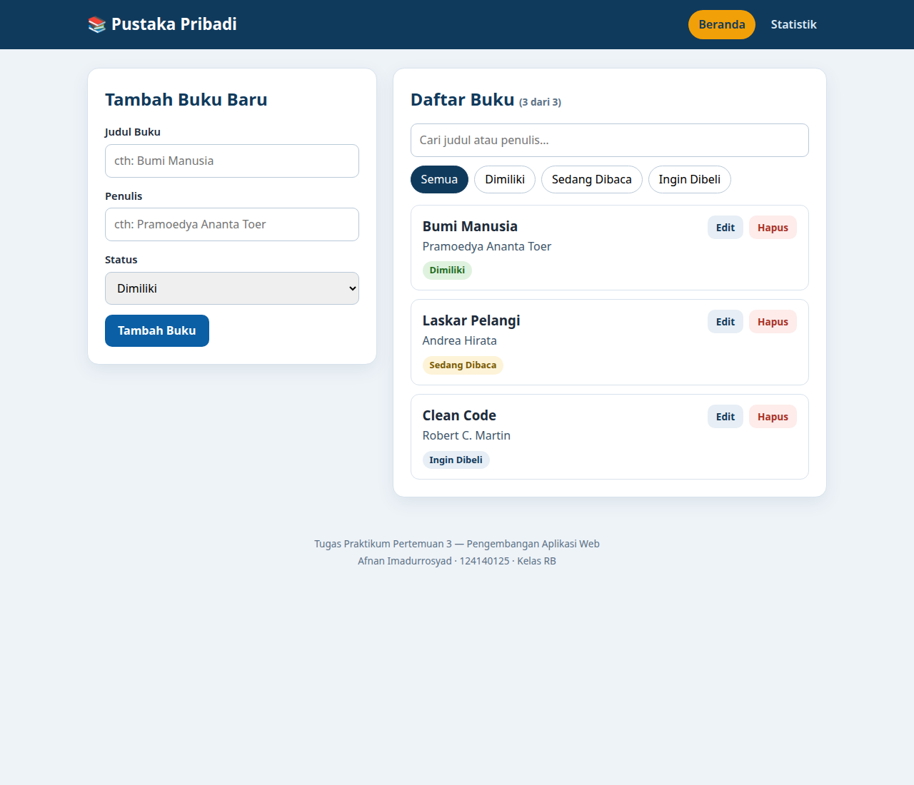
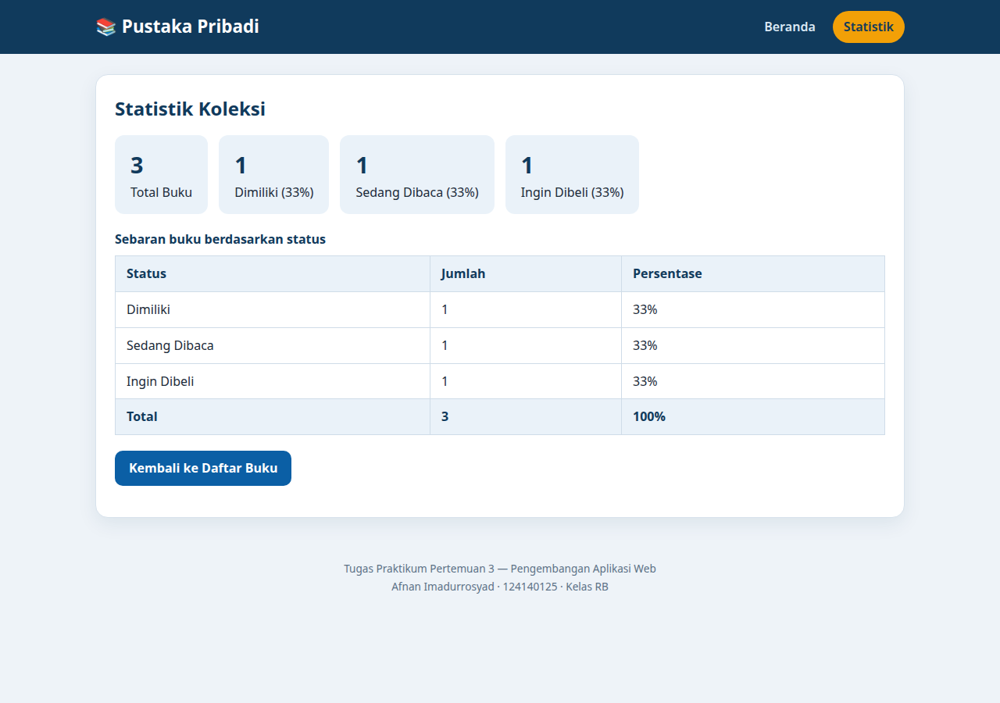
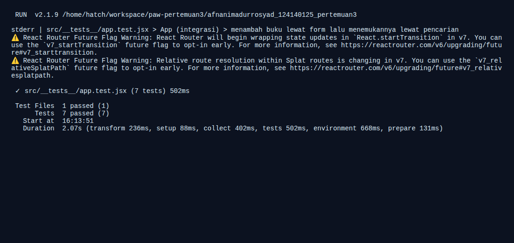

# Pustaka Pribadi — Aplikasi Manajemen Buku

**Nama:** Afnan Imadurrosyad
**NIM:** 124140125
**Kelas:** RB
**Mata Kuliah:** Pengembangan Aplikasi Web — Praktikum Pertemuan 3 (React Basics)

## Deskripsi Aplikasi

Pustaka Pribadi adalah aplikasi manajemen buku pribadi berbasis React. Pengguna
dapat mencatat buku yang dimiliki, sedang dibaca, atau ingin dibeli; mengedit dan
menghapus buku; memfilter buku berdasarkan status; serta mencari buku berdasarkan
judul atau nama penulis. Data tersimpan persisten di `localStorage` sehingga tidak
hilang saat halaman dimuat ulang. Aplikasi memiliki dua halaman: Beranda (formulir
dan daftar buku) dan Statistik (ringkasan koleksi).

## Cara Menjalankan di VS Code

```bash
# 1. Masuk ke folder project
cd afnanimadurrosyad_124140125_pertemuan3

# 2. Pasang dependensi (sekali saja)
npm install

# 3. Jalankan aplikasi (mode pengembangan)
npm run dev

# Buka alamat yang ditampilkan terminal, biasanya http://localhost:5173
```

Perintah lain yang tersedia:

```bash
npm run build   # membangun versi produksi ke folder dist/
npm test        # menjalankan unit test (Vitest)
```

## Screenshot Antarmuka

### Halaman Beranda — formulir tambah buku dan daftar buku



### Halaman Statistik — ringkasan koleksi dan tabel sebaran status



## Fitur

- **Tambah buku** — judul, penulis, dan status (Dimiliki / Sedang Dibaca / Ingin Dibeli).
- **Edit dan hapus buku** — tombol Edit mengisi ulang formulir dengan data buku,
  tombol Hapus meminta konfirmasi sebelum menghapus.
- **Filter berdasarkan status** — chip Semua / Dimiliki / Sedang Dibaca / Ingin Dibeli.
- **Pencarian** — berdasarkan judul atau nama penulis (tidak peka huruf besar-kecil).
- **Penyimpanan persisten** — seluruh data buku disimpan di `localStorage`.
- **Validasi form** — judul dan penulis wajib diisi; pesan error tampil di bawah
  field yang kosong dan pengiriman dibatalkan sampai field terisi.
- **Data awal** — tiga buku contoh ditampilkan saat aplikasi pertama dibuka.

## Fitur React yang Digunakan

| Konsep | Implementasi |
| --- | --- |
| Functional components + Hooks | Seluruh komponen ditulis sebagai function component. |
| `useState` | State form, filter, pencarian, dan buku yang sedang diedit. |
| `useEffect` | Sinkronisasi state buku ke `localStorage` (di dalam `useLocalStorage`) dan pengisian form saat mode edit. |
| `useMemo` | Daftar buku hasil filter/pencarian dan nilai Context dihitung ulang hanya saat dependensinya berubah. |
| Context API | `BookContext` menyediakan `books`, `addBook`, `updateBook`, dan `deleteBook` ke semua halaman tanpa prop drilling. |
| React Router | Navigasi multi-halaman: `/` (Beranda) dan `/stats` (Statistik). |
| Custom hooks | `useLocalStorage` (state persisten) dan `useBookStats` (statistik turunan). |
| PropTypes | Type checking pada seluruh komponen (`BookForm`, `BookFilter`, `BookList`, `BookCard`, `BookProvider`). |
| Controlled components | Setiap input form dikendalikan penuh oleh state React. |
| Conditional rendering & lists | Empty state saat daftar kosong; daftar dirender dengan `key` stabil (id buku). |

## Struktur Folder

```
src/
├── components/
│   ├── BookForm/BookForm.jsx       # formulir tambah/edit + validasi
│   ├── BookList/BookList.jsx       # daftar buku + kartu buku
│   └── BookFilter/BookFilter.jsx   # pencarian + filter status
├── pages/
│   ├── Home/Home.jsx               # halaman Beranda
│   └── Stats/Stats.jsx             # halaman Statistik
├── hooks/
│   ├── useLocalStorage.js          # custom hook penyimpanan persisten
│   └── useBookStats.js             # custom hook statistik koleksi
├── context/BookContext.jsx         # Context API + state buku
├── __tests__/app.test.jsx          # unit test
├── App.jsx                         # Router + Provider
└── main.jsx                        # entry point
```

## Laporan Testing

Unit test ditulis dengan Vitest dan React Testing Library
(`src/__tests__/app.test.jsx`). Total **7 test, semuanya lulus**:

1. `useLocalStorage` menyimpan dan membaca nilai dari localStorage.
2. `useBookStats` menghitung total dan sebaran status dengan benar.
3. `BookForm` menampilkan pesan error dan tidak memanggil `onSubmit` saat field kosong.
4. `BookForm` memanggil `onSubmit` dengan data saat form valid.
5. `BookFilter` meneruskan perubahan status dan pencarian ke parent.
6. `BookList` menampilkan empty state saat kosong dan kartu buku saat ada data.
7. Integrasi `App`: menambah buku lewat form, lalu menyaringnya lewat pencarian.


