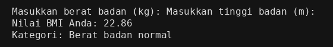
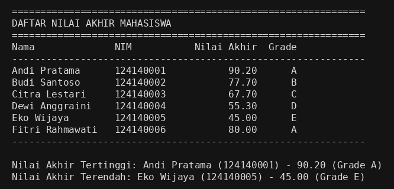
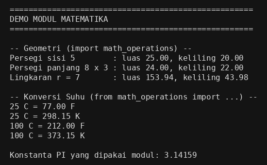

# Dasar Pemrograman Python — Praktikum Pertemuan 4

**Nama:** Afnan Imadurrosyad
**NIM:** 124140125
**Kelas:** RB
**Mata Kuliah:** Pengembangan Aplikasi Web — Praktikum Pertemuan 4 (Python Dasar)

## Deskripsi

Tiga program Python yang menguji pemahaman variabel, struktur kendali
(if-else dan loop), modularitas fungsi, struktur data koleksi
(list dan dictionary), serta pembuatan modul kustom:

1. **Program Penghitung BMI** (`tugas1_bmi.py`, bobot 30%) — menghitung
   BMI dari berat (kg) dan tinggi (m) dengan rumus
   `BMI = berat / (tinggi * tinggi)`, lalu menentukan kategori
   (kurang, normal, berlebih, obesitas) dengan `if-elif-else`.
   Hasil BMI dicetak dengan 2 angka desimal menggunakan f-string.
2. **Pengelolaan Data Nilai Mahasiswa** (`tugas2_nilai_mahasiswa.py`,
   bobot 40%) — menyimpan minimal 5 data mahasiswa dalam list of
   dictionary (`nama`, `nim`, `nilai_uts`, `nilai_uas`,
   `nilai_tugas`), menghitung nilai akhir dengan bobot
   30% UTS + 40% UAS + 30% tugas, menentukan grade A–E, menampilkan
   seluruh data dalam tabel rapi, serta mencari nilai akhir tertinggi
   dan terendah. Data mahasiswa di program ini adalah data contoh
   untuk demonstrasi perhitungan, bukan data nilai nyata.
3. **Modul Matematika** (`math_operations.py` + `main.py`, bobot 30%) —
   modul berisi fungsi luas dan keliling persegi, persegi panjang,
   dan lingkaran; konversi suhu Celsius ke Fahrenheit dan Celsius ke
   Kelvin; serta konstanta `PI = 3.14159`. Program utama `main.py`
   mengimpor dan memakai seluruh fungsi modul dengan dua cara impor
   yang berbeda (`import math_operations` dan
   `from math_operations import ...`).

Setiap fungsi dilengkapi docstring yang menjelaskan parameter input
dan nilai kembaliannya. Kode memakai indentasi 4 spasi yang konsisten
dan penamaan snake_case sesuai PEP 8.

## Cara Menjalankan di VS Code

```bash
# 1. Masuk ke folder project
cd afnanimadurrosyad_124140125_pertemuan4

# 2. Jalankan masing-masing program di terminal VS Code
python tugas1_bmi.py
python tugas2_nilai_mahasiswa.py
python main.py
```

Untuk Soal 1, program akan meminta berat badan (kg) dan tinggi badan
(m) lewat `input()`. Contoh input yang dipakai pada screenshot di
bawah: berat 70 kg, tinggi 1.75 m, menghasilkan BMI 22.86
(Berat badan normal).

## Screenshot Hasil Eksekusi

### Soal 1 — Program Penghitung BMI



### Soal 2 — Pengelolaan Data Nilai Mahasiswa



### Soal 3 — Modul Matematika dan Program Utamanya



## Struktur Folder

```
afnanimadurrosyad_124140125_pertemuan4/
├── .gitignore
├── README.md
├── tugas1_bmi.py
├── tugas2_nilai_mahasiswa.py
├── math_operations.py
├── main.py
├── screenshot-tugas1-bmi.png
├── screenshot-tugas2-nilai.png
└── screenshot-tugas3-modul.png
```

`.gitignore` sudah mencantumkan `venv/` dan `__pycache__/` agar
keduanya tidak terunggah ke repositori.
