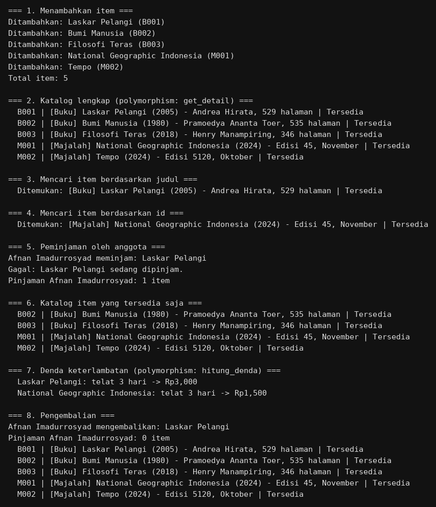

# Sistem Manajemen Perpustakaan Sederhana — Praktikum Pertemuan 5

**Nama:** Afnan Imadurrosyad
**NIM:** 124140125
**Kelas:** RB
**Mata Kuliah:** Pengembangan Aplikasi Web — Praktikum Pertemuan 5 (Python OOP)

## Deskripsi Program

Sistem manajemen perpustakaan sederhana berbasis OOP Python. Program
dapat menambahkan item ke perpustakaan, menampilkan katalog item yang
tersedia, mencari item berdasarkan judul atau id, serta meminjam dan
mengembalikan item lewat anggota perpustakaan. Data buku dan majalah
pada demo adalah data contoh untuk demonstrasi fitur.

Empat pilar OOP yang diterapkan:

- **Abstraction (30%):** `LibraryItem` adalah abstract class (ABC)
  dengan method abstract `get_detail()` dan `hitung_denda()` yang
  wajib diimplementasikan tiap subclass; class ini tidak bisa
  diinstansiasi langsung.
- **Inheritance (30%):** `Book` dan `Magazine` mewarisi
  `LibraryItem` (constructor, status pinjam, property) dan
  meng-override `get_detail()` serta `hitung_denda()` sesuai
  jenisnya.
- **Encapsulation (25%):** id, judul, dan status pinjam disimpan
  sebagai atribut private (`__id`, `__judul`, `__dipinjam`),
  tahun terbit sebagai protected (`_tahun_terbit`); koleksi
  `Library` disimpan sebagai `__koleksi` private. Akses hanya
  lewat property (`id`, `judul`, `is_dipinjam`, `status`) dan
  method (`pinjam()`, `kembalikan()`, `tambah_item()`).
- **Polymorphism (20%):** `get_detail()` dan `hitung_denda()`
  dipanggil lewat referensi `LibraryItem` yang sama tetapi
  berperilaku berbeda per subclass — denda buku Rp1.000/hari,
  majalah Rp500/hari.

## Struktur Folder

```text
afnanimadurrosyad_124140125_pertemuan5/
├── latihan/
│   ├── 01_everything_is_object.py
│   ├── 01_procedural_vs_oop.py
│   ├── 02_class_object.py
│   ├── 03_inheritance.py
│   ├── 04_encapsulation.py
│   ├── 05_polymorphism.py
│   └── 06_abstract_class.py
├── tugas_perpustakaan/
│   ├── library_item.py   # LibraryItem (ABC), Book, Magazine
│   ├── member.py         # Member (anggota peminjam)
│   ├── library.py        # Library (koleksi, katalog, pencarian)
│   └── main.py           # Demo seluruh fungsionalitas
├── .gitignore
├── README.md
└── screenshot-output.png
```

Folder `latihan/` berisi latihan hands-on dari modul (konsep OOP langkah
demi langkah); folder `tugas_perpustakaan/` berisi tugas Sistem Manajemen
Perpustakaan Sederhana.

## Panduan Menjalankan Program

```bash
# 1. Masuk ke folder tugas
cd afnanimadurrosyad_124140125_pertemuan5/tugas_perpustakaan

# 2. Jalankan program demo
python main.py
```

Program tidak meminta input interaktif; demo langsung menampilkan
penambahan 3 buku + 2 majalah, katalog lengkap, pencarian judul
("pelangi") dan id ("M001"), peminjaman, katalog tersedia saja,
denda keterlambatan, dan pengembalian.

## Screenshot Output


