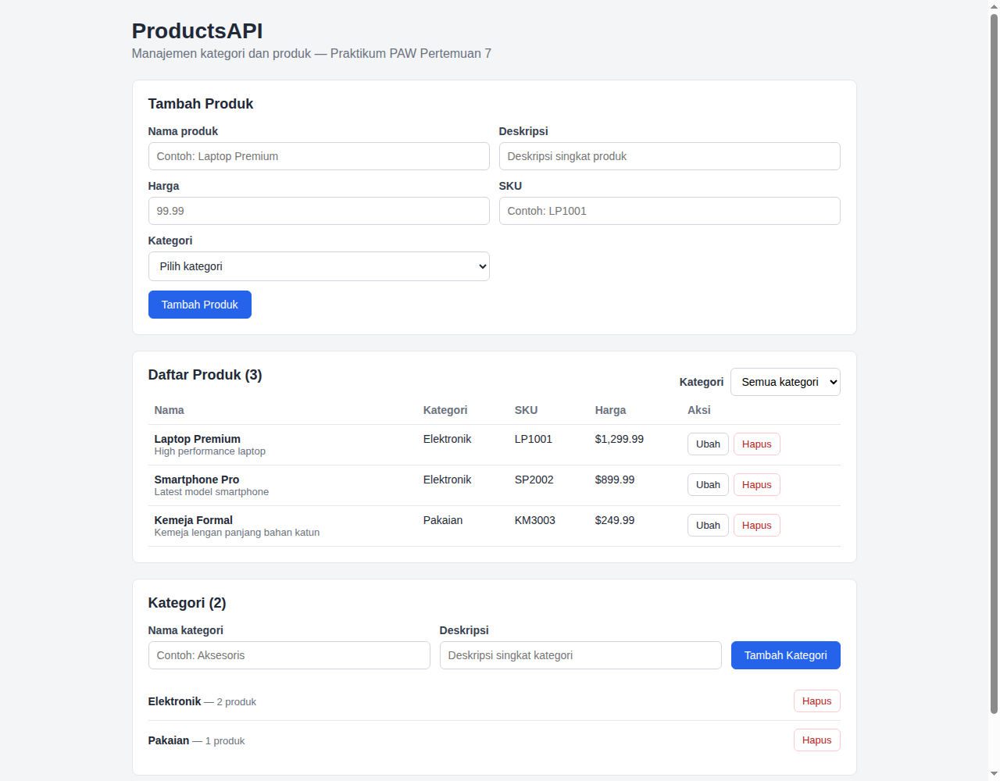
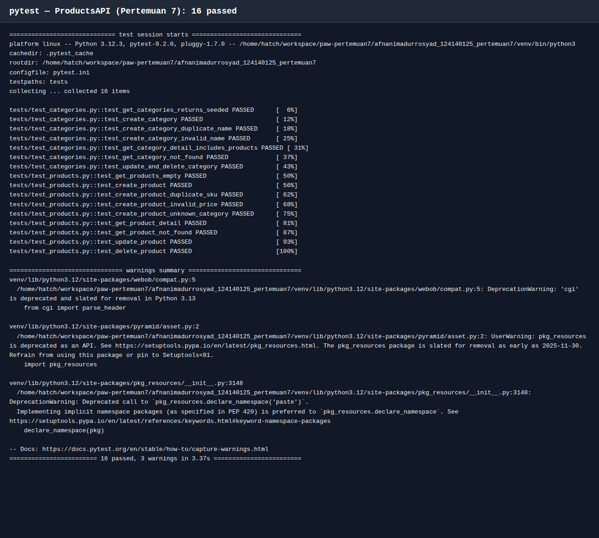
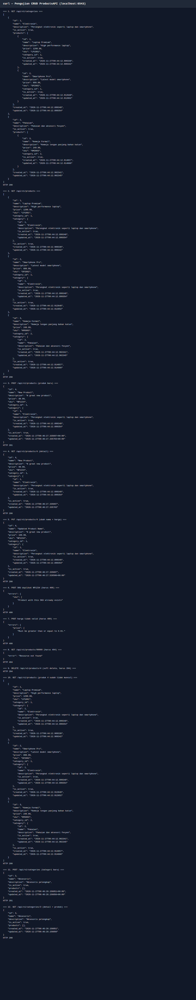

# ProductsAPI — Praktikum PAW Pertemuan 7

REST API manajemen kategori dan produk berbasis Pyramid, SQLAlchemy, Alembic, dan Marshmallow.

## Identitas

- Nama: Afnan Imadurrosyad
- NIM: 124140125
- Kelas: RB
- Mata Kuliah: Pengembangan Aplikasi Web (Praktikum)
- Pertemuan: 7 — Basis Data: SQLAlchemy, Alembic & Pyramid
- Deadline: Rabu, 9 Desember 2026, 23.59 WIB

## Deskripsi

ProductsAPI adalah layanan REST API untuk mengelola katalog produk yang dikelompokkan ke dalam kategori.

### Relasi Dua Model

- **Category** (`categories`) berelasi satu-ke-banyak (1:N) dengan **Product** (`products`).
- `Product.category_id` adalah foreign key ke `Category.id`, dilengkapi `relationship` SQLAlchemy dua arah (`Category.products` dan `Product.category`).
- Satu kategori dapat memiliki banyak produk; setiap produk hanya dimiliki oleh satu kategori.
- Menghapus kategori atau produk dilakukan secara *soft delete* (`is_active = False`) sehingga riwayat data tetap terjaga.

### Model

**Category** (`categories`)

| Kolom | Tipe | Keterangan |
| --- | --- | --- |
| id | Integer | Primary key |
| name | String(100) | Nama kategori, unik, wajib |
| description | Text | Deskripsi kategori, opsional |
| is_active | Boolean | Penanda aktif (soft delete) |
| created_at | DateTime | Waktu dibuat (otomatis) |
| updated_at | DateTime | Waktu terakhir diubah (otomatis) |

**Product** (`products`)

| Kolom | Tipe | Keterangan |
| --- | --- | --- |
| id | Integer | Primary key |
| name | String(100) | Nama produk, wajib |
| description | Text | Deskripsi produk, opsional |
| price | Float | Harga produk, wajib, minimal 0.01 |
| sku | String(50) | Kode produk, unik, wajib |
| category_id | Integer | Foreign key ke `categories.id`, wajib |
| is_active | Boolean | Penanda aktif (soft delete) |
| created_at | DateTime | Waktu dibuat (otomatis) |
| updated_at | DateTime | Waktu terakhir diubah (otomatis) |

## Daftar Endpoint

### Kategori

| Method | Endpoint | Fungsi | Status Sukses |
| --- | --- | --- | --- |
| GET | `/api/v1/categories` | Mengambil seluruh daftar kategori aktif | `200 OK` |
| POST | `/api/v1/categories` | Membuat kategori baru (cek nama unik) | `201 Created` |
| GET | `/api/v1/categories/{id}` | Mengambil detail satu kategori aktif | `200 OK` |
| PUT | `/api/v1/categories/{id}` | Memperbarui kategori aktif secara parsial | `200 OK` |
| DELETE | `/api/v1/categories/{id}` | Soft delete kategori | `204 No Content` |

### Produk

| Method | Endpoint | Fungsi | Status Sukses |
| --- | --- | --- | --- |
| GET | `/api/v1/products` | Mengambil seluruh daftar produk aktif | `200 OK` |
| POST | `/api/v1/products` | Membuat produk baru (cek SKU unik dan kategori) | `201 Created` |
| GET | `/api/v1/products/{id}` | Mengambil detail satu produk aktif | `200 OK` |
| PUT | `/api/v1/products/{id}` | Memperbarui produk aktif secara parsial | `200 OK` |
| DELETE | `/api/v1/products/{id}` | Soft delete produk | `204 No Content` |

Respons error: `400 Bad Request` untuk validasi gagal atau SKU/nama duplikat, `404 Not Found` untuk ID yang tidak ada atau sudah tidak aktif.

## Struktur Proyek

```text
afnanimadurrosyad_124140125_pertemuan7/
├── development.ini          # Konfigurasi pengembangan (pserve port 6543)
├── production.ini           # Konfigurasi produksi
├── testing.ini              # Konfigurasi pytest (SQLite in-memory)
├── pytest.ini               # Konfigurasi pytest
├── setup.py                 # Definisi paket dan dependensi
├── .env.example             # Contoh konfigurasi database
├── products_api/
│   ├── __init__.py          # Entry point, konfigurasi CORS dan .env
│   ├── routes.py            # Peta rute REST API
│   ├── models/              # Model SQLAlchemy (Category, Product, BaseModel)
│   ├── schemas/             # Schema validasi Marshmallow
│   ├── services/            # Service layer (logika bisnis)
│   ├── views/               # View handler CRUD dan CORS preflight
│   ├── alembic/             # Migrasi database Alembic
│   └── scripts/             # Script seeding data contoh
├── tests/                   # Unit test pytest
└── frontend/                # Frontend React + Vite (bonus)
```

## Instalasi

Prasyarat: Python 3.10-3.13, PostgreSQL 15/16/17, Node.js 20/22 LTS (untuk frontend).

```bash
# 1. Buat dan aktifkan virtual environment
python -m venv venv
source venv/bin/activate        # Linux/macOS
# venv\Scripts\activate         # Windows

# 2. Instal paket aplikasi beserta dependensi pengujian
pip install -e ".[testing]"

# 3. Buat database PostgreSQL
psql -U postgres -h localhost -c "CREATE DATABASE products_api_db;"
```

## Konfigurasi .env

Salin `.env.example` menjadi `.env` lalu sesuaikan isinya:

```bash
cp .env.example .env
```

Isi `.env`:

```ini
# Konfigurasi Database
DB_USER=postgres
DB_PASSWORD=postgres
DB_HOST=localhost
DB_PORT=5432
DB_NAME=products_api_db

# Konfigurasi Aplikasi
APP_SECRET=products-api-secret
DEBUG=true
```

File `.env` berisi kredensial dan tidak diunggah ke repositori (terdaftar di `.gitignore`).

## Migrasi Database (Alembic)

```bash
# Membuat file migrasi baru secara otomatis dari model
alembic -c development.ini revision --autogenerate -m "Pesan migrasi"

# Menerapkan migrasi ke database PostgreSQL
alembic -c development.ini upgrade head

# Memeriksa tabel yang terbentuk
psql -U postgres -h localhost -d products_api_db -c "\dt"
```

## Seeding Data Contoh

```bash
python -m products_api.scripts.initialize_db
```

Perintah ini mengisi 2 kategori contoh (Elektronik dan Pakaian) beserta 3 produk contoh. Aman dijalankan berulang kali (idempoten, dicek berdasarkan nama kategori dan SKU produk).

## Menjalankan Server

```bash
pserve development.ini
```

Server berjalan di `http://localhost:6543`. Halaman `/` menampilkan informasi proyek dan daftar endpoint.

Contoh pengujian dengan `curl`:

```bash
# GET semua produk
curl -X GET http://localhost:6543/api/v1/products

# POST membuat produk baru
curl -X POST http://localhost:6543/api/v1/products \
  -H "Content-Type: application/json" \
  -d '{"name": "New Product", "description": "A great new product", "price": 99.99, "sku": "NP1234", "category_id": 1}'

# GET detail produk
curl -X GET http://localhost:6543/api/v1/products/1

# PUT memperbarui produk
curl -X PUT http://localhost:6543/api/v1/products/1 \
  -H "Content-Type: application/json" \
  -d '{"name": "Updated Product Name", "price": 109.99}'

# DELETE (soft delete) produk
curl -X DELETE http://localhost:6543/api/v1/products/1
```

## Menjalankan Pengujian

```bash
pytest
```

Pengujian memakai `testing.ini` dengan database SQLite in-memory, sehingga tidak mengganggu database PostgreSQL. Test mencakup endpoint produk dan kategori: daftar, tambah, detail, ubah, hapus, validasi gagal (400), dan ID tidak ditemukan (404).

## Menjalankan Frontend React (Bonus)

Frontend berada di folder `frontend/` (React + Vite) dan mengakses API di `http://localhost:6543`.

```bash
cd frontend
npm install
npm run dev        # mode pengembangan di http://localhost:5173
npm run build      # build produksi
```

Pastikan server backend (`pserve development.ini`) sudah berjalan sebelum memakai frontend.

## Screenshot






